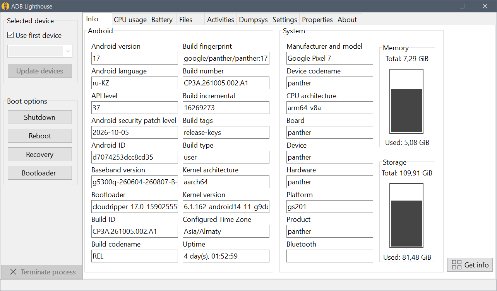
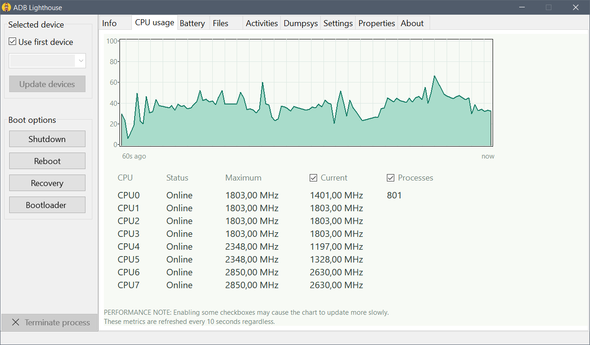
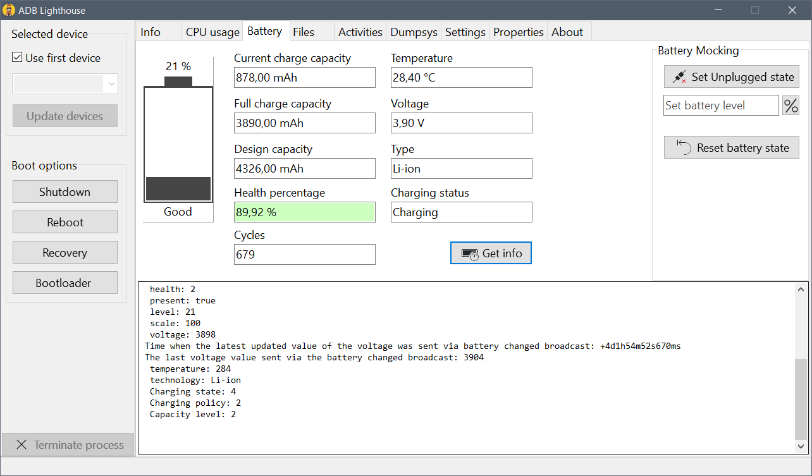
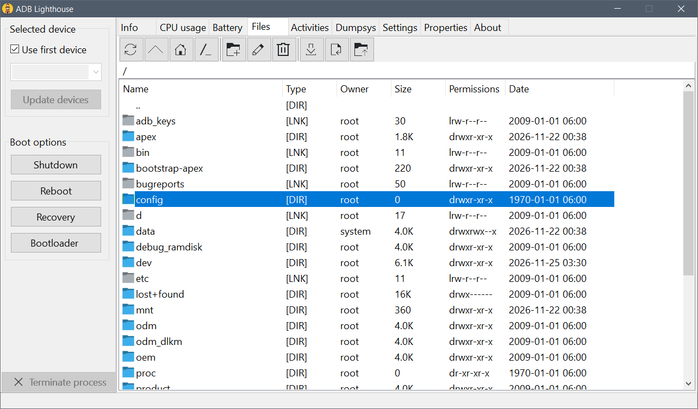
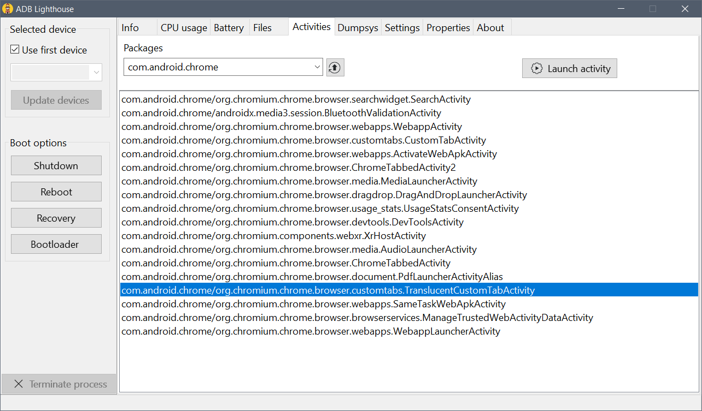
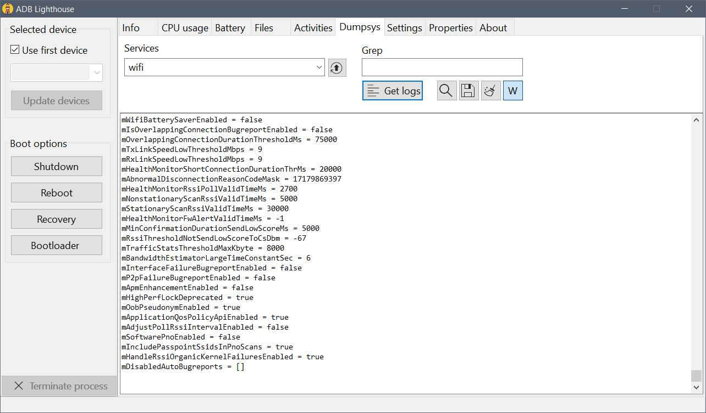
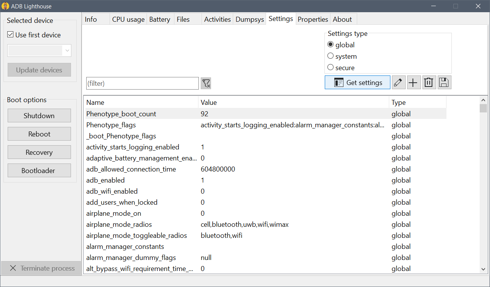
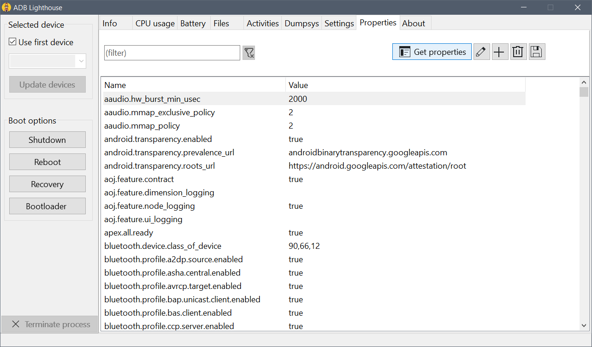

# ADB Lighthouse

A graphical interface for working with Android devices through the Android Debug Bridge (ADB).
<small>Repository for distribution</small>

## Features

- View battery level, health, temperature, voltage, and charge cycles.
- Monitor live CPU usage, core status and speed, and the number of running processes.
- View Android, device, build, and kernel details, plus memory, storage, and uptime.
- Browse Android services, search and filter `dumpsys` output.
- Find installed apps and launch their activities.
- Browse device files and folders, transfer files.
- View, add, edit, and delete Android system properties and settings. Filter lists and save them to a file.

## Getting Started

1. Connect your Android device with USB debugging enabled and authorize the computer.
2. Run the application.

## Screenshots

<small>Written in Lazarus</small>
